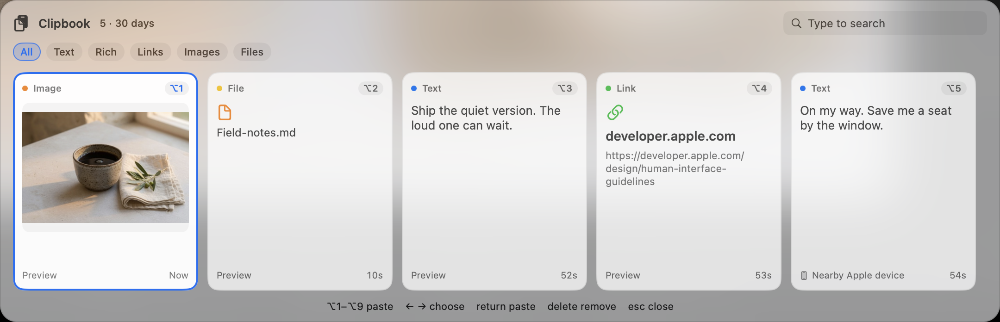

# Clipbook

Open-source clipboard manager for macOS. Press **⌘⇧V** and a shelf of cards slides up from the bottom of the screen: the text, rich text, links, images, and files you copied over the last 30 days. Click a card, or press **⌥1** through **⌥9**, to paste it back.

Clipbook is free to use and free to change. It stays on this Mac. It has no account and no iCloud history.

I made it because [Paste](https://pasteapp.io) kept nagging me to pay with every upgrade. I wanted that kind of shelf without a subscription. [Grok 4.7 (high)](https://x.ai) built this app with me.



## Features

- Menu-bar app with no Dock icon. It starts when you log in.
- **⌘⇧V** opens a shelf on the screen under the pointer, just above the Dock.
- Cards for text, rich text, links, images, and files, each marked with its type.
- **⌥1**–**⌥9** paste the first nine cards you can see. Arrow keys, Return, Delete, and Esc work too.
- Type to search. Filter chips narrow the shelf to text, rich text, links, images, or files.
- Thirty days of history, up to 5,000 items. Copying the same thing again moves it to the front.
- A copy from a nearby iPhone, iPad, or Mac is labeled **Nearby Apple device** once Universal Clipboard delivers it. Clipbook then keeps that copy here for 30 days.
- Passwords and other concealed clipboard items are skipped.
- Pause capturing, or clear history, from the menu-bar icon.

While Clipbook is running, **⌘⇧V** opens the shelf. In many apps that shortcut is Paste and Match Style.

## macOS versions

Clipbook requires **macOS 14 Sonoma or later**. The project is developed on macOS 27. The build script compiles for the Mac you are on, Apple silicon or Intel.

On macOS 27 the permission below is named **Device Control and Data Access**. On macOS 14 through 26 the same permission is named **Accessibility**.

## Permissions

Clipbook asks for one privacy permission.

| Permission | When you need it |
| --- | --- |
| Device Control and Data Access, or Accessibility on older macOS | **⌥1**–**⌥9**, pasting straight into the app you were using, typing to search while the shelf is open, and clicking outside the shelf to close it |
| Login item | Starts Clipbook when you log in. macOS lists it under System Settings → General → Login Items |

**⌘⇧V** still opens the shelf if that permission is off. A click then copies the card, and you press **⌘V** yourself.

Clipbook does not ask for Screen Recording, Full Disk Access, Automation, or iCloud. History is a SQLite database and a folder of payloads in `~/Library/Application Support/Clipbook`, readable only by your user.

Universal Clipboard is Apple’s feature, not an extra Clipbook permission. A nearby copy arrives when Handoff is on, Bluetooth and Wi-Fi are on, both devices use the same Apple ID, and they are near each other. Clipbook stores the copy locally after it lands. It does not sync a history of its own through iCloud.

## Install

You need Xcode or the Xcode Command Line Tools.

```bash
git clone https://github.com/chungskie/clipbook.git
cd clipbook
./scripts/build.sh
```

The script runs the tests, builds `Clipbook.app`, installs it to `~/Applications`, and registers a LaunchAgent so it opens at login. The first time you open the shelf, allow Clipbook under **Device Control and Data Access** (or **Accessibility**). If the switch was already on for an older build, remove Clipbook from that list and turn the new switch on, then quit and reopen Clipbook.

Right-click the clipboard icon in the menu bar and choose **Quit Clipbook** to stop it.

To uninstall:

```bash
launchctl bootout "gui/$(id -u)/com.schnappi.clipbook"
rm -rf ~/Applications/Clipbook.app \
  ~/Library/LaunchAgents/com.schnappi.clipbook.plist \
  ~/Library/Application\ Support/Clipbook
```

## Keyboard

| Shortcut | Action |
| --- | --- |
| ⌘⇧V | Open or close the shelf |
| ⌥1 – ⌥9 | Paste that card |
| ← → | Move the selection |
| Return | Paste the selection |
| Delete | Remove the selection |
| Esc | Clear the search, then close |
| Type | Search |

## How a nearby copy is saved

When you copy on an iPhone and Universal Clipboard delivers it, macOS writes the data onto this Mac’s clipboard and marks it as a remote clipboard. Clipbook reads that mark, labels the card **Nearby Apple device**, and keeps the payload on disk for 30 days. The same path covers an iPad or another Mac. Clipbook cannot tell those devices apart. If the data shows up a moment later, Clipbook waits and tries again.

## Contributing

Read [AGENTS.md](AGENTS.md) before changing the code. `./scripts/build.sh` runs the self-test and installs a local build.

## License

[MIT](LICENSE) © Chung Han
